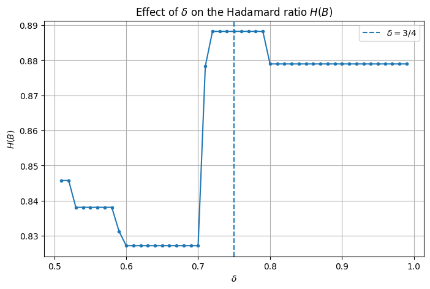

# Lattice-Based Cryptography

**Molly Shi · Undergraduate mathematics project**

A study of how lattice basis geometry affects reduction, approximate closest-vector calculations, and small public-key cryptosystem examples. The project connects abstract algebra and lattice theory with Python implementations of Gaussian reduction, LLL, GGH, and NTRUEncrypt.

The [project notes](lattice_notes.pdf) develop the mathematics and worked examples across 133 pages. The code and [executed LLL notebook](lll_lattice_reduced.ipynb) provide computational entry points.

## A basis changes the calculation

Different bases can generate the same lattice while giving very different results when coordinates are rounded. The experiments measure basis quality with the Hadamard ratio, compare the shortest vector **among the returned basis vectors**, and record the number of LLL swaps.

For the fixed six-dimensional matrix in [the LLL script](lll_lattice_reduced.py):

| Case | Lovász parameter | Swaps | Hadamard ratio | Shortest basis-vector norm |
| --- | ---: | ---: | ---: | ---: |
| Input basis | — | — | 0.46908 | 51.91339 |
| Original ordering | 0.75 | 19 | 0.88824 | 26.73948 |
| Reversed ordering | 0.75 | 11 | 0.87897 | 26.73948 |
| Original ordering | 0.99 | 22 | 0.87897 | 26.73948 |

The absolute determinant remains **777,406,251**. These values are recorded in the supplied executed notebook and in [CSV form](lll_results.csv). They describe one matrix, rather than a benchmark over random lattices.



*Existing notebook output: varying the Lovász parameter from 0.51 to 0.99 does not monotonically improve this basis-quality measure.*

## Explore the implementations

| File | What it demonstrates |
| --- | --- |
| [gaussian_lra_dim2.py](gaussian_lra_dim2.py) | Two-dimensional Gaussian reduction with a step-by-step trace |
| [lll_lattice_reduced.py](lll_lattice_reduced.py) | Gram–Schmidt, size reduction, the Lovász condition, ordering comparisons, and parameter plots |
| [ggh_cryptosystem_ex.py](ggh_cryptosystem_ex.py) | A fixed three-dimensional GGH example: private-basis recovery versus public-basis rounding |
| [ggh_crypto.py](ggh_crypto.py) | Randomized GGH examples, perturbation tests, 30 trials, and text encoding |
| [ntru_crypto.py](ntru_crypto.py) | Cyclic convolution, polynomial inversion, key checks, encryption, and decryption with N=7, p=3, q=41 |
| [ggh_game.py](ggh_game.py) | A terminal demonstration of key generation, message encryption, and decryption |
| [ggh_interactive_game.html](ggh_interactive_game.html) | A standalone browser demonstration from Alice's, Bob's, and Eve's perspectives |

The function called `babai` uses **coordinate rounding in the supplied basis**. It does not implement the Gram–Schmidt nearest-plane variant. See [methods and interpretation](methods.md) for conventions and a correction to the NTRU candidate test in the notes.

## Run

Use Python 3.12 and run commands from the repository root. The examples were checked with NumPy 2.3.5, SymPy 1.14.0, and Matplotlib 3.11.2.

```bash
python3 -m venv .venv
source .venv/bin/activate
python -m pip install -r requirements.txt
python gaussian_lra_dim2.py
python ggh_cryptosystem_ex.py
python ntru_crypto.py
python lll_lattice_reduced.py
```

The LLL script prints the comparisons and opens five plots. On a machine without a graphical display, use `MPLBACKEND=Agg python lll_lattice_reduced.py` to run the numerical calculations. The saved notebook retains the original plot outputs.

Run `python ggh_game.py` for the terminal demonstration, or download and open `ggh_interactive_game.html` in a browser. GitHub displays the HTML source; it does not run the game on the file page. The HTML requires no external libraries or network connection.

The randomized extension can be run with `python ggh_crypto.py`. Its messages, keys, and success counts vary between runs; the historical 30-trial experiment is described in the project notes, pp. 98–110.

## Further reading

The implementations use floating-point linear algebra and Python/NumPy random generators. [Methods](methods.md) explains the arithmetic conventions and parameter choices.

The [notes](lattice_notes.pdf) cover algebra (pp. 4–25), lattices (pp. 26–49), GGH and NTRUEncrypt (pp. 64–78), reduction algorithms (pp. 79–89), and small cryptanalysis examples (pp. 90–93). Page numbers refer to the printed pages in the PDF. The report's GGH and NTRU attack discussions are worked mathematical examples; dedicated attack scripts are not included.

The worked cryptosystem examples draw on Jeffrey Hoffstein, Jill Pipher, and Joseph H. Silverman, *An Introduction to Mathematical Cryptography*, 2nd ed., Springer, 2014. The notes also reference Joseph A. Gallian, *Contemporary Abstract Algebra*, 7th ed., 2010. Their bibliography remains in the report; third-party textbook PDFs are not redistributed here.
